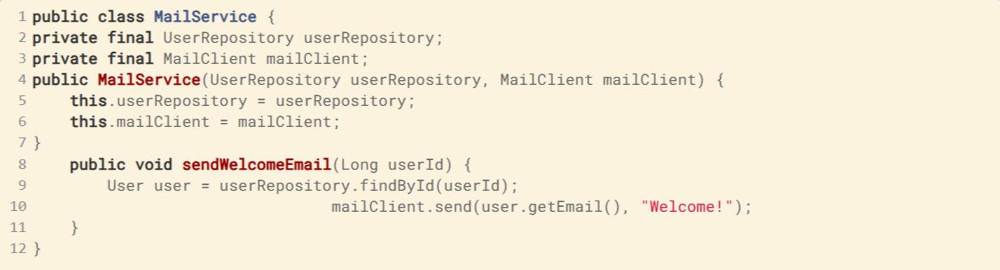

### Пример 2
Ситуация: сервис отправляет письмо пользователю. Репозиторий может вернуть null.


***Промт:***
> Ты код-ревьер, работаешь с сервисом, который отправляет письма.
``` Java
public class MailService {  
private final UserRepository userRepository;  
private final MailClient mailClient;  
public MailService(UserRepository userRepository, MailClient mailClient) {    
    this.userRepository = userRepository;    
    this.mailClient = mailClient;  
}  
    public void sendWelcomeEmail(Long userId) {    
        User user = userRepository.findById(userId);     
				mailClient.send(user.getEmail(), "Welcome!");  
    }
}
```

> Твоя задача проверить код на ошибки, наличие уязимостей и т.д.
Не предлагай рефакторинг без причины.
Формат ответа:
> - blocker/major/minor
> - что не так, риск(высокий/средний/низкий), как исправить

***Ответ ИИ:***
blocker — userRepository.findById(userId) может вернуть null, после чего user.getEmail() даст NullPointerException.  
Риск: высокий — падение отправки welcome-письма и исключение наружу.  
Как исправить: обработать отсутствие пользователя. Если репозиторий возвращает Optional, использовать orElseThrow(...); если возвращает User, явно проверить user == null и бросить доменное исключение либо залогировать и выйти.

major — user.getEmail() не проверяется на null, пустую строку и валидность.
Риск: средний/высокий — NPE внутри mailClient.send или отправка на некорректный адрес.
Как исправить: перед отправкой проверить email на null/blank и валидность; при невалидном значении — лог + пропуск отправки или доменное исключение, в зависимости от контракта метода.

minor — userId не валидируется.
Риск: низкий/средний — поведение findById(null) зависит от реализации репозитория: возможен некорректный запрос или неожиданное исключение.
Как исправить: если null недопустим, добавить Objects.requireNonNull(userId, "userId") или IllegalArgumentException.

minor — конструктор не проверяет userRepository и mailClient на null.
Риск: низкий — при ручном создании сервиса с null ошибка проявится позже, в месте использования.  
Как исправить: добавить Objects.requireNonNull(...) для обеих зависимостей.

minor — нет явной обработки исключений mailClient.send.
Риск: средний — сбой почтового клиента может сломать основной сценарий, если welcome-письмо не критично.
Как исправить: определить политику: пробрасывать ошибку, логировать и продолжать или отправлять асинхронно/через outbox, если письмо не должно влиять на основной поток.

Явных уязвимостей в приведённом фрагменте не видно: тема письма фиксированная, пользовательский ввод в заголовки не подставляется. Основные риски — null-значения и отсутствие валидации email.


### Классификация замечаний
|Замечание ИИ| Тип(корректное/сомнительное/ошибочное) | "Светофор"(Accept/Reject/Verefy) | Приоритет(blocker/major/minor) | Что делаем дальше                                                                                                              |
|-|--------------------------|-----------|--------------------------------|--------------------------------------------------------------------------------------------------------------------------------|
|userRepository.findById(userId) может вернуть null| Корректное               | Verify    | blocker                        | проверить контракт UserRepository (User или Optional<User>) и выбрать поведение при отсутствии пользователя: доменное исключение, лог + выход или orElseThrow. Добавить тест на отсутствующего пользователя                                                                               |
|user.getEmail() не проверяется на null, пустую строку и валидность.| Корректное               | Verify    | major                          | проверить, валидирует ли MailClient email и какие требования у бизнеса. Добавить проверку на null/blank минимум; валидность email и политику пропуска/исключения подтвердить тестами. |
|userId не валидируется.| Корректное               | Verify    | minor                          | проверить публичный контракт метода и поведение репозитория с null. Если null недопустим — добавить Objects.requireNonNull/IllegalArgumentException и тест. |
|конструктор не проверяет userRepository и mailClient на null.| Корректное               | Accept    | minor                          | добавить Objects.requireNonNull(...) для обеих зависимостей в конструкторе. Исправление локальное и безопасное. |
|нет явной обработки исключений mailClient.send| Cомнительное             | Verify                                 |minor| уточнить требования: welcome-письмо критично для сценария или нет. Проверить failure-path тестами и решить: пробрасывать ошибку, логировать и продолжать или выносить отправку в асинхронный/outbox-процесс.|                                                                                                                                                                      

## PR

1. Возможен NullPointerException, если пользователь не найден  

Что не так: userRepository.findById(userId) может вернуть null, после чего user.getEmail() падает с NPE.  
Риск: высокий — падение отправки welcome-письма и исключение наружу.  
Как исправить: обработать отсутствие пользователя:
- если репозиторий возвращает Optional<User> — orElseThrow(...);  
- если возвращает User — явно проверить user == null и бросить доменное исключение либо залогировать и не отправлять письмо.  
Приоритет: blocker

2. Email пользователя не проверяется

Что не так: user.getEmail() может быть null, пустым или невалидным.  
Риск: средний/высокий — NPE внутри mailClient.send или отправка на некорректный адрес.  
Как исправить: перед отправкой проверить email на null/blank и валидность. При невалидном значении — лог + пропуск отправки или доменное исключение, в зависимости от контракта метода.  
Приоритет: major


3. userId не валидируется

Что не так: поведение findById(null) зависит от реализации репозитория.  
Риск: низкий/средний — возможен некорректный запрос или неожиданное исключение.  
Как исправить: если null недопустим, добавить Objects.requireNonNull(userId, "userId") или IllegalArgumentException.  
Приоритет: minor

4. Зависимости не проверяются в конструкторе

Что не так: userRepository и mailClient могут быть переданы как null.  
Риск: низкий — при ручном создании сервиса ошибка проявится позже, в месте использования.  
Как исправить: добавить Objects.requireNonNull(...) для обеих зависимостей в конструкторе.   
Приоритет: minor

5. Нет явной обработки исключений mailClient.send

Что не так: сбой почтового клиента пробрасывается наружу без явной политики обработки.  
Риск: средний — если welcome-письмо не критично, сбой почтового клиента может сломать основной сценарий.  
Как исправить: уточнить требования и выбрать политику: пробрасывать ошибку, логировать и продолжать или отправлять асинхронно/через outbox.  
Приоритет: minor

### Next Step

#### 🔴 Исправить до merge (blocker)
1. Обработать отсутствие пользователя в sendWelcomeEmail:
  - если findById возвращает Optional<User> — orElseThrow(...);
  - если возвращает User — проверить user == null и бросить доменное исключение либо залогировать и не отправлять письмо.
2.Добавить тест на отсутствующего пользователя, чтобы зафиксировать выбранное поведение.

#### 🟡 Вынести в отдельную задачу (major/minor)
 - major: добавить проверку email пользователя на null/blank/валидность перед вызовом mailClient.send; определить политику при невалидном email.
 - minor: валидировать userId (Objects.requireNonNull/IllegalArgumentException), если null недопустим по контракту.
 - minor: добавить Objects.requireNonNull(...) для userRepository и mailClient в конструкторе.
 - minor: определить и реализовать политику обработки исключений mailClient.send: пробрасывать, логировать и продолжать или отправлять асинхронно/через outbox.

#### 🟢 Тесты, которые стоит добавить
 - Пользователь не найден → ожидаемое доменное исключение или пропуск отправки с логом.
 - Пользователь найден, email null → нет NPE, поведение соответствует выбранной политике.
 - Пользователь найден, email пустой/blank → нет отправки, поведение соответствует выбранной политике.
 - Пользователь найден, email невалидный → поведение соответствует выбранной политике.
 - Успешный сценарий: пользователь найден, email валиден → mailClient.send вызван с правильными аргументами.
 - mailClient.send бросает исключение → поведение соответствует выбранной политике обработки ошибок.
 - userId == null → ожидаемое исключение валидации, если null недопустим.
 - Конструктор с null-зависимостями → NullPointerException/IllegalArgumentException на этапе создания.


